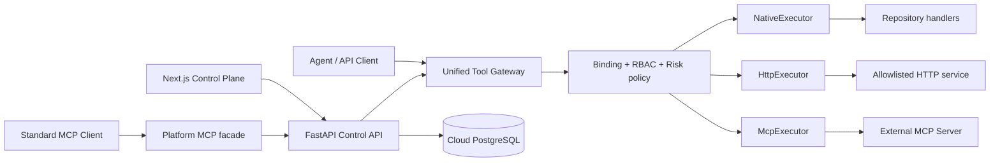

# Phase 3 架构

Control Plane 管理“是什么、谁能用、使用哪个版本”：Agent、Tool、不可变 ToolVersion、绑定、MCP discovery 快照、权限和审计。

Execution Plane 负责“这一次如何安全执行”：解析身份与绑定、固定版本、验证 JSON Schema、策略决策、分派 Executor、超时/有限重试、结果校验、脱敏与 Execution 记录。

外部 MCP 不做隐式同步。Discovery 只刷新远端声明的快照；Import 才会创建平台 ToolVersion。远端 schema 变化显示为 `changed`，管理员必须使用新版本显式导入。

平台 MCP facade 是反向适配层。每次 `tools/list` 都向 Control API 请求指定 Agent 和 Principal 当前可用的 Tool，因此 disabled、deprecated、未绑定或未授权 Tool 不会暴露给 MCP Client。
